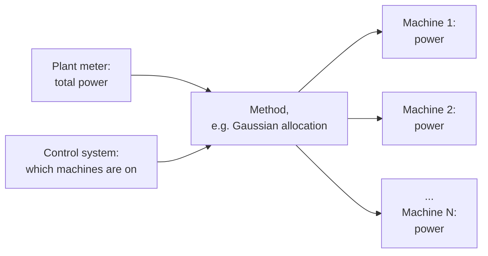

# Power per machine from one factory meter

> **In short:** give it a factory's total power and which machines are on. It tells you how much power each machine uses.
> Best method: **Gaussian allocation**, off by **6.2 W** per machine on average, or 101 W while the machine runs (a simple split: 16.9 W, or 273 W while running).

## What it does



* **In:** the total power from the plant's main meter, and each machine's on/off state (a plant usually has this already, from its control system, the PLC).
* **Out:** each machine's power, for every sample.
* **Why it helps:** no meter is needed on each machine. This is called NILM: non-intrusive load monitoring.

## Try it

Needs [uv](https://docs.astral.sh/uv/).

```sh
uv run src/preprocessing/fetch_hipe.py   # 1. download the HIPE data: 1.3 GB, 31 GB unpacked
uv run src/preprocessing/hipe.py         # 2. build training and test sets: about 30 min
uv run src/allocation/allocation.py --dataset hipe --machines 9   # 3. run the best method
uv run src/validation/validation.py      # 4. score it
```

Every Python folder has a self-check: `uv run src/<folder>/test_<name>.py`.

## Methods

| Method | Code | How it works |
|---|---|---|
| **Gaussian allocation** | [`src/allocation`](src/allocation) | Learns each machine's typical power levels (idle, heating, ...), then splits the total among the running machines in the most likely way. |
| Neural network | [`src/neural_network`](src/neural_network) | A small neural network, trained to make the running machines' estimates add up to the total. |
| Polynomial model | [`src/polynomial`](src/polynomial) | Each machine's power is a polynomial of the total, fitted by optimisation algorithms. C++: needs CMake and a C++20 compiler. |
| Hart-inspired | [`src/hart_inspired`](src/hart_inspired) | Reads each machine's power from the drop in the total when it switches off. |

How each method works, with one worked example: [docs/methods.md](docs/methods.md).

The neural network and the polynomial model come from my MSc dissertation (University of Coimbra, 2023). Gaussian allocation was added later.

## Results

**Gaussian allocation wins on every HIPE group. The neural network comes second, the only other method to beat the simple proportional split.**


*Blue: metered power. Orange: Gaussian allocation's estimate. Four of the nine machines in HIPE group 9, on a busy December morning (data: KIT, CC BY 4.0).*
*Mostly a close match. The main miss is around 09:30: both ovens run at once, and part of the SolderingOven's power goes to the HighTemperatureOven.*

* **Data:** [HIPE](https://www.energystatusdata.kit.edu/hipe.php), ten machines at an electronics production site in Germany, each with its own meter.
* **Test:** add the machine meters into a total, let each method split it back, and compare with the real meters. Repeated for nine groups of 2 to 10 machines.
* **Fair:** tuned on October 2017, trained on November, scored on December, a month no method saw beforehand.

| Method | Average error per machine (W) | While it runs (W) |
|---|---|---|
| **Gaussian allocation** | **6.2** | **101** |
| Neural network | 11.4 | 185 |
| Simple split: in proportion to each machine's average power | 16.9 | 273 |
| Polynomial model | 19.0 | 309 |
| Simple split: equally among the running machines | 28.4 | 454 |
| Hart-inspired | 49.6 | 789 |
| Guess 0 W (= the machines' average power) | 51.4 | 820 |

* **Average error** counts every second of December. The machines are off most of the time, and there every method is exactly right (0 W), so this number is small.
* **While it runs** counts only the seconds a machine draws power.

On a second dataset, [IMDELD](https://ieee-dataport.org/open-access/industrial-machines-dataset-electrical-load-disaggregation), no method does much better than a simple guess, and Gaussian allocation does worse. Its machines almost always switch on and off together, so their power can't be told apart.

## Limits

* **It needs to know when each machine is on,** but copes with small errors there. States 10 s late: 6.4 W instead of 6.2 W. 60 s late: 7.3 W. 1% of the one-second on/off readings flipped: 7.9 W. Still far ahead of the simple split given the same states (17.7 and 19.2 W).
* **Machines that always run together can't be told apart.**
* **More detailed states would help most.** Told also when each oven is heating, it would be off by about 3.4 W instead of 6.2 W. [How.](docs/notes.md#more-than-on-and-off-a-heating-flag)

## More

* [docs/methods.md](docs/methods.md): how each method works, in plain words, with one example.
* [docs/notes.md](docs/notes.md): every number, option and design choice, with a table to jump to what you need.
* [src/polynomial/README.md](src/polynomial/README.md): building and running the polynomial model.

## License

[CC BY-NC-SA 4.0](LICENSE), © 2023 [Daniel Torres](https://github.com/danctorres). The datasets keep their own terms.
