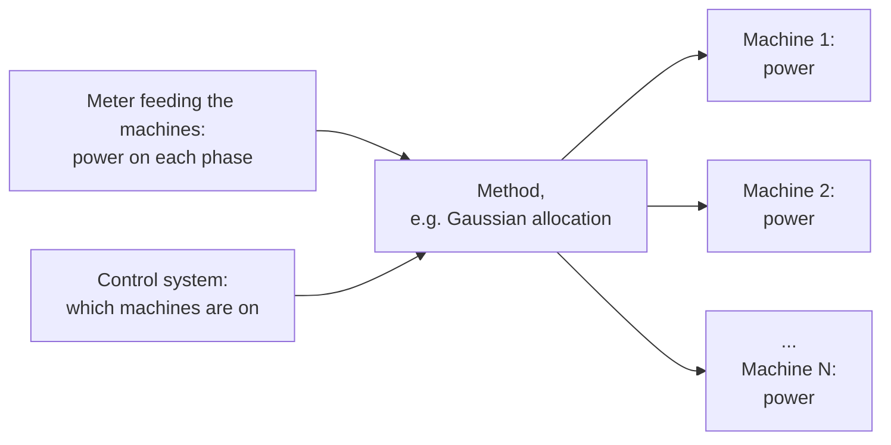
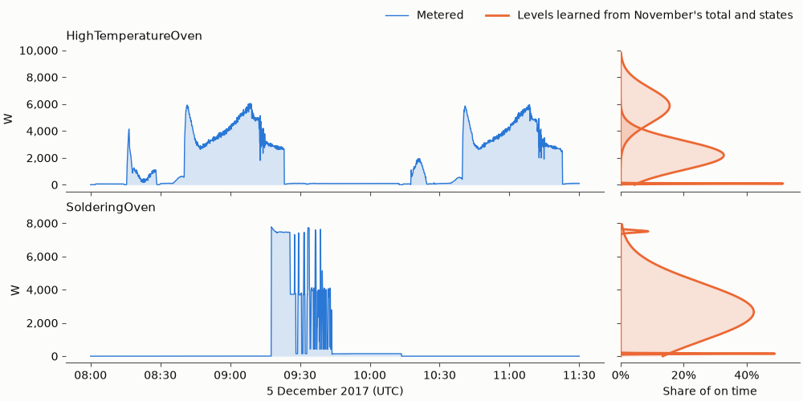
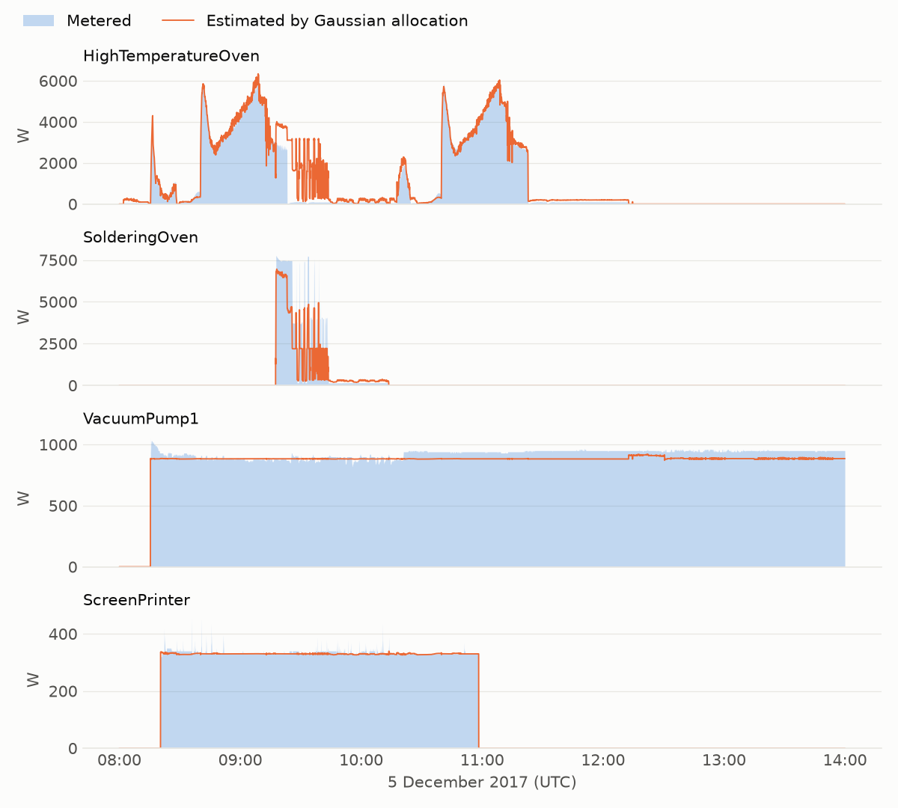

# Power per machine from one factory meter

> **In short:** give it the power on one meter that feeds a factory's machines, and which machines are on. It tells you how much power each machine uses.
> Best method: **Gaussian allocation** on the meter's [per-phase readings](#per-phase-readings), off by **2.1 W** per machine on average, against 16.9 W for a simple split.

## What it does



* **In:** the power on one meter that feeds only these machines, ideally on each phase, and each machine's on/off state, e.g. from the plant's control system (PLC).
* **Out:** each machine's power, for every sample.
* **Why it helps:** no meter is needed on each machine. This is called NILM: non-intrusive load monitoring.
* **Where it's used:** known as virtual submetering, done before for the parts of a [machine tool](https://link.springer.com/chapter/10.1007/978-3-030-02203-7_9) and for [HVAC in buildings](https://arxiv.org/abs/1509.05421). This repo tests it on whole machines.

### Per-phase readings

A factory meter reads more than one total:

* **3 wires,** or phases: L1, L2, L3. A machine may use one, two or all three.
* **2 readings on each:** active power (kW), which does the work, and reactive power (kvar), which flows back and forth without doing any.
* **So 6 readings.** Each machine moves them its own way, so Gaussian allocation can tell apart machines the total can't.


*Each oven heats on its own phases, with its own reactive power.*

## Try it

Needs [uv](https://docs.astral.sh/uv/).

```sh
uv run src/preprocessing/fetch_hipe.py   # 1. download the HIPE data: 1.3 GB, 31 GB unpacked
uv run src/preprocessing/hipe.py         # 2. build training and test sets: under an hour
uv run src/allocation/allocation.py --dataset hipe --machines 9 --phases   # 3. run the best method
uv run src/validation/validation.py      # 4. score it
```

Every Python folder has a self-check: `uv run src/<folder>/test_<name>.py`.

## Methods

| Method | Code | How it works |
|---|---|---|
| **[Gaussian allocation](docs/methods.md#gaussian-allocation)** | [`src/allocation`](src/allocation) | Learns each machine's typical power levels (idle, heating, ...), then splits the total among the running machines in the most likely way. With `--phases`, it splits the active and reactive power on each phase instead. |
| [Neural network](docs/methods.md#neural-network) | [`src/neural_network`](src/neural_network) | A small neural network, trained to make the running machines' estimates add up to the total. With `--phases`, it reads the per-phase readings instead of the total. |
| [Hart-inspired](docs/methods.md#hart-inspired) | [`src/hart_inspired`](src/hart_inspired) | Reads each machine's power from the drop in the total when it switches off, an idea from [Hart's 1992 NILM method](https://doi.org/10.1109/5.192069). |

* **How each method works:** [docs/methods.md](docs/methods.md).
* **Every number and design choice:** [docs/notes.md](docs/notes.md).



*Gaussian allocation learns each oven's power levels without seeing its meter. They match where the meter reads.*

## Results

**Gaussian allocation wins on every HIPE group, by far with the per-phase readings.**



*From the per-phase readings, Gaussian allocation follows both ovens' meters.*

* **Data:** [HIPE](https://www.energystatusdata.kit.edu/hipe.php), ten machines at a German electronics factory, each with its own meter.
* **Test:** add the machine meters into a total, let each method split it back, and compare. Nine groups of 2 to 10 machines.
* **Fair:** tuned on October 2017, trained on November, scored on December.

| Method | Average error per machine (W) | While it runs (W) |
|---|---|---|
| **[Gaussian allocation, per-phase readings](docs/methods.md#with-per-phase-readings)** | **2.1** | **33** |
| [Gaussian allocation](docs/methods.md#gaussian-allocation), total only | 6.2 | 101 |
| [Neural network](docs/methods.md#neural-network), per-phase readings | 8.4 | 136 |
| [Neural network](docs/methods.md#neural-network), total only | 11.4 | 185 |
| [Simple split](docs/methods.md#baselines) by each machine's average power | 16.9 | 273 |
| [Hart-inspired](docs/methods.md#hart-inspired) | 49.6 | 789 |
| [Guess 0 W](docs/methods.md#baselines) | 51.4 | 820 |

* **Average error:** over every second of December. Machines are mostly off, where every method is exact, so it's small.
* **While it runs:** only the seconds a machine draws power.
* **Guess 0 W:** what knowing nothing costs. Hart-inspired barely beats it.

On a second dataset, [IMDELD](https://ieee-dataport.org/open-access/industrial-machines-dataset-electrical-load-disaggregation), no method does much better than a simple guess, and Gaussian allocation does worse: its machines almost always switch on and off together.

## Limits

* **The total must hold only the machines' power.** Meter the machines' feeder on its own. HIPE's main meter is 96% other load, and there it does worse than guessing 0 W. [Why.](docs/notes.md#how-the-total-is-made)
* **It needs each machine's on/off state,** e.g. from the plant's control system. Small delays and glitches cost little. [How much.](docs/notes.md#why-the-states-must-be-given)
* **Machines that always run together can't be told apart.**

## License

[MIT](LICENSE), © 2023 [Daniel Torres](https://github.com/danctorres). The datasets keep their own terms. The figures use HIPE data by KIT, [CC BY 4.0](https://creativecommons.org/licenses/by/4.0/), processed.
