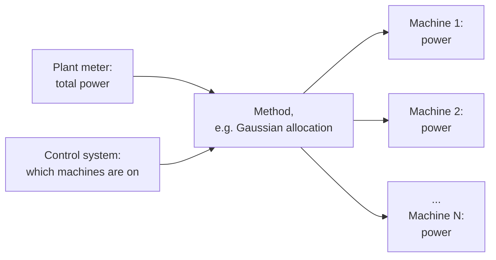

# Power per machine from one factory meter

> **In short:** give it a factory's total power and which machines are on. It tells you how much power each machine uses.
> Best method: **Gaussian allocation**, off by **6.2 W** per machine on average, or 101 W while the machine runs (a simple split: 16.9 W, or 273 W while running). Given the meter's per-phase readings: **2.1 W**, or 33 W while running.

## What it does



* **In:** the total power from the plant's main meter, or better its readings on each phase, and each machine's on/off state, which a plant's control system (the PLC) may already have.
* **Out:** each machine's power, for every sample.
* **Why it helps:** no meter is needed on each machine. This is called NILM: non-intrusive load monitoring.
* **Where it's used:** splitting one meter using control-system states is known as virtual submetering. It has been done for the parts of a [machine tool](https://link.springer.com/chapter/10.1007/978-3-030-02203-7_9), from their PLC states, and for [HVAC in buildings](https://arxiv.org/abs/1509.05421). This repo measures how well it works for whole machines, with HIPE's per-machine meters as the answer key.

## Try it

Needs [uv](https://docs.astral.sh/uv/).

```sh
uv run src/preprocessing/fetch_hipe.py   # 1. download the HIPE data: 1.3 GB, 31 GB unpacked
uv run src/preprocessing/hipe.py         # 2. build training and test sets: under an hour
uv run src/allocation/allocation.py --dataset hipe --machines 9 --phases   # 3. run the best method
uv run src/validation/validation.py      # 4. score it
```

Every Python folder has a self-check: `uv run src/<folder>/test_<name>.py`.

## Methods

| Method | Code | How it works |
|---|---|---|
| **Gaussian allocation** | [`src/allocation`](src/allocation) | Learns each machine's typical power levels (idle, heating, ...), then splits the total among the running machines in the most likely way. With `--phases`, it splits the active and reactive power on each phase instead. |
| Neural network | [`src/neural_network`](src/neural_network) | A small neural network, trained to make the running machines' estimates add up to the total. |
| Hart-inspired | [`src/hart_inspired`](src/hart_inspired) | Reads each machine's power from the drop in the total when it switches off. |

How each method works, with one worked example: [docs/methods.md](docs/methods.md).

The neural network comes from my MSc dissertation (University of Coimbra, 2023). Gaussian allocation was added later. The dissertation's polynomial model was dropped: [why](docs/notes.md#tried-and-dropped).

## Results

**Gaussian allocation wins on every HIPE group, by far when it gets the meter's per-phase readings. The neural network comes second, the only other method to beat the simple proportional split.**


*Blue: metered power. Orange: Gaussian allocation's estimate from the total alone. Four of the nine machines in HIPE group 9, on a busy December morning (data: KIT, CC BY 4.0).*
*Mostly a close match. The main miss is around 09:30: both ovens run at once, and part of the SolderingOven's power goes to the HighTemperatureOven.*

* **Data:** [HIPE](https://www.energystatusdata.kit.edu/hipe.php), ten machines at an electronics production site in Germany, each with its own meter.
* **Test:** add the machine meters into a total, let each method split it back, and compare with the real meters. Repeated for nine groups of 2 to 10 machines.
* **Fair:** tuned on October 2017, trained on November, scored on December, a month no method saw beforehand.

| Method | Average error per machine (W) | While it runs (W) |
|---|---|---|
| **Gaussian allocation, per-phase readings** | **2.1** | **33** |
| Gaussian allocation, total only | 6.2 | 101 |
| Neural network | 11.4 | 185 |
| Simple split: in proportion to each machine's average power | 16.9 | 273 |
| Simple split: equally among the running machines | 28.4 | 454 |
| Hart-inspired | 49.6 | 789 |
| Guess 0 W (= the machines' average power) | 51.4 | 820 |

* **Average error** counts every second of December. The machines are off most of the time, and there every method is exactly right (0 W), so this number is small.
* **While it runs** counts only the seconds a machine draws power.
* **Per-phase readings:** active and reactive power on each of the 3 phases, which a three-phase plant meter reports. The ovens heat on different phases, with different reactive power, so the readings show which one is heating. The other methods use the total only. [How.](docs/methods.md#with-per-phase-readings)

On a second dataset, [IMDELD](https://ieee-dataport.org/open-access/industrial-machines-dataset-electrical-load-disaggregation), no method does much better than a simple guess, and Gaussian allocation does worse. Its machines almost always switch on and off together, so their power can't be told apart.

## Limits

* **The total must hold only the machines' power.** Here it is the sum of their meters. HIPE's real main meter is 96% other load (the machines are 0.58 kW of 14.0 kW). Splitting it with the other load as one more machine, Gaussian allocation is off by 212–247 W in December on groups 9 and 10, far worse than guessing 0 W (41–67 W). The machines run when the plant is busy, so the other load follows them. A real plant must meter the machines' feeder apart. [How the total is made.](docs/notes.md#how-the-total-is-made)
* **It needs to know when each machine is on.** Here the states come from each machine's own meter. A control system's would lag and glitch, and the methods cope with small errors there. States 10 s late: 6.4 W instead of 6.2 W. 60 s late: 7.3 W. 1% of the one-second on/off readings flipped: 7.9 W. Still far ahead of the simple split given the same states (17.7 and 19.2 W).
* **Machines that always run together can't be told apart.**
* **What's left is missing information, not a weak method.** On HIPE, the per-phase readings cut the error from 6.2 W to 2.1 W. A heating flag for each oven, taken from the oven's own meter (a best case), cut it to 3.4 W. How much a real plant gains depends on its machines: ovens on the same phases, with the same reactive power, would gain nothing. [How.](docs/notes.md#more-than-on-and-off-a-heating-flag)

## More

* [docs/methods.md](docs/methods.md): how each method works, in plain words, with one example.
* [docs/notes.md](docs/notes.md): every number, option and design choice, with a table to jump to what you need.

## License

[CC BY-NC-SA 4.0](LICENSE), © 2023 [Daniel Torres](https://github.com/danctorres). The datasets keep their own terms.
