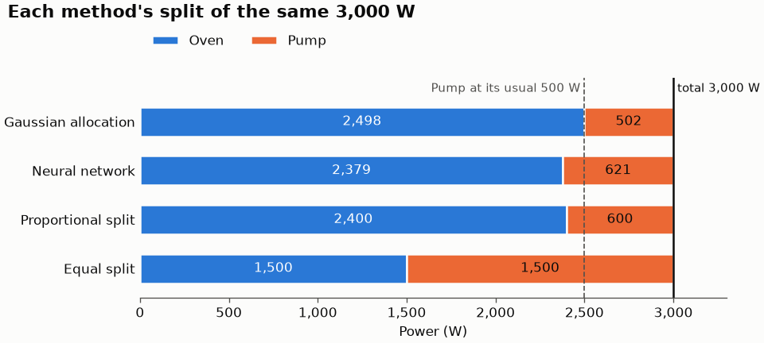
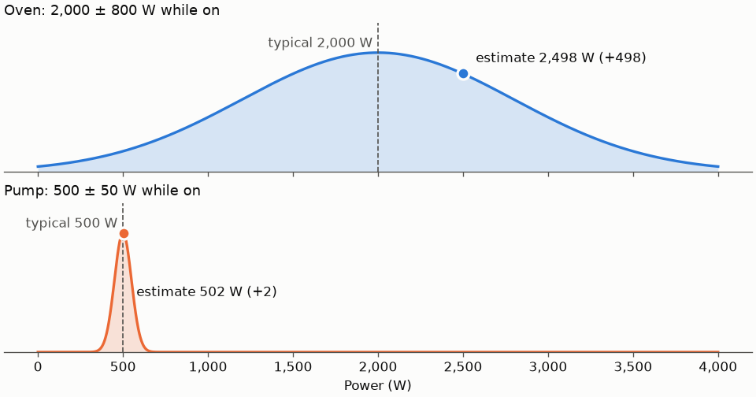

# How the methods work

> **In short:** every method gets the same two inputs: the total power and which machines are on. Each one splits the total among the running machines, and they differ only in how they pick the split. Every section uses the same example, so you can compare them.

| Method | Idea in one line | December error (W) |
|---|---|---|
| [Gaussian allocation](#gaussian-allocation) | Give the leftover to the machine whose power varies most | **6.2** |
| [Neural network](#neural-network) | Learn each machine's share of the total | 11.4 |
| [Proportional split](#baselines) | Split in proportion to each machine's average power | 16.9 |
| [Equal split](#baselines) | Split equally among the running machines | 28.4 |
| [Hart-inspired](#hart-inspired) | Read a machine's power from the drop when it switches off | 49.6 |
| [Guess 0 W](#baselines) | Say 0 W, always | 51.4 |

*Error: the average gap per machine over every second of December, on HIPE. See [Words](notes.md#words).*

## The example

> Made-up numbers, used in every section.

* **Total right now:** 3,000 W.
* **On:** the Oven and the Pump. **Off:** the Printer, so every method gives it 0 W.
* **What the training rows showed:**
  * **Oven:** about 2,000 W, but it swings a lot (± 800 W).
  * **Pump:** about 500 W, and very steady (± 50 W).
* **The question:** how much of the 3,000 W is the Oven's?

*Not shown: guess 0 W (0 and 0), and Hart-inspired, which gives the Pump the drop when it switches off. Redraw with `uv run docs/figures.py`.*

## What every method gets

> **In short:** the total and the on/off states. Never the machines' own meters.

* **The total:** the plant meter's power, every second.
* **The states:** for each machine, on or off, every second. A plant's control system (the PLC) may already have these. How they are made from the data: [On or off](notes.md#on-or-off).
* **Training rows:** 19,600 seconds of November to learn from. Each method then splits every second of December.
* **The machines' own meters** are only used to score the result, never to train.
* **An OFF machine gets 0 W** from every method. What's left to decide is how the running machines share the total.

## Why splitting is hard

> **In short:** many splits add up to the same total. Each method is a different rule for picking one.

* **One machine on:** easy. It gets the whole total.
* **Two or more on:** 2,500 + 500, 2,000 + 1,000 and 1,500 + 1,500 all add up to 3,000 W. The total alone can't say which split is right.
* **So every method needs a rule**, learned from the training rows, to pick a split.
* **Machines that always run together** can't be told apart by any rule. That's why no method does much better than a simple guess on IMDELD: [Why IMDELD cannot be split](notes.md#why-imdeld-cannot-be-split).

## Baselines

> **In short:** three simple guesses. A method is only worth using if it beats them.

**Idea:** fixed rules with little or nothing to learn.

**Steps:**
1. **Guess 0 W:** every machine gets 0 W, always.
2. **Equal split:** the total ÷ the number of running machines.
3. **Proportional split:** learn each machine's average power from the training totals (a least-squares fit of the total on the states). Then split the total in proportion to those averages.

**Example:**

| Baseline | Oven (W) | Pump (W) |
|---|---|---|
| Guess 0 W | 0 | 0 |
| Equal split | 1,500 | 1,500 |
| Proportional split (2,000 : 500, so 80% : 20%) | 2,400 | 600 |

**Good at:** the proportional split is hard to beat. Only two methods do (16.9 W).
**Bad at:** they ignore how much each machine's power varies.

**Code:** `baselines` in [validation.py](../src/validation/validation.py). They run during scoring and have no command of their own.

## Gaussian allocation

> **In short:** learn how much each machine's power varies, then give most of any leftover to the machine that varies most. The best method: 6.2 W.

**Idea:** a steady machine is probably at its usual power, so whatever the total adds on top belongs to the machine that swings.

**Steps:**
1. **Learn each machine's power while it's on** as a bell curve: a typical value and a spread. It learns them from the training totals and states alone. See [How it learns the curves](#how-it-learns-the-curves).
2. **At each second,** add up the running machines' typical values and compare that with the total. The difference is the leftover.
3. **Share the leftover** in proportion to each machine's variance (its spread squared). The estimates then add up to the total.
4. **3 levels per machine** (the default): each machine gets three bell curves, e.g. idle, warming up and heating. It tries every combination of the running machines' levels, weights each by how well it explains the total, and averages them.

**Example, 1 level:**
* Typical values: 2,000 + 500 = 2,500 W. Leftover: 3,000 − 2,500 = 500 W.
* Variances: Oven 800² = 640,000, Pump 50² = 2,500. The Oven gets 640,000 ÷ 642,500 = 99.6% of the leftover.
* **Oven ≈ 2,498 W, Pump ≈ 502 W.** The steady Pump stays at its usual power.

**Example, 3 levels:** say the Oven idles at 300 W and heats at 2,400 W.
* Oven heating + Pump = 2,900 W. Close to 3,000 W, so likely.
* Oven idle + Pump = 800 W. Far from 3,000 W, so it barely counts.

**Good at:** HIPE. It's best on every group, and still 7.0 W with only 1 level per machine.
**Bad at:** big machines with wide levels running at the same time.
* If it knew each machine's true level, its October error would fall from 6.14 to 1.6 W.
* Looking at neighbouring seconds didn't help: [Tried and dropped](notes.md#tried-and-dropped).
* **Slow** when many machines are on at once, since it tries every combination of levels.

**Code:** [allocation.py](../src/allocation/allocation.py). `--components K`: levels per machine, 3 by default.

### How it learns the curves

> **In short:** guess the curves, split the training totals with them, re-learn the curves from those splits, and repeat until nothing changes. This loop is called EM (expectation-maximisation).

**Why it has to guess first:** it's a chicken-and-egg problem.
* To split a total, it needs each machine's curve.
* To learn a machine's curve, it needs that machine's share of many totals.
* It never sees a machine's own meter, so it can't measure either one directly.

**Four made-up training rows:**

| Row | On | Total (W) |
|---|---|---|
| A | Pump | 510 |
| B | Oven | 1,900 |
| C | Oven and Pump | 2,600 |
| D | Oven and Pump | 3,000 |

**Round 1:**
1. **Guess.** Oven 2,000 ± 800 W, Pump 500 ± 200 W. The code's own first guess is each machine's average from a least-squares fit, the same one the proportional split uses.
2. **Split each row** with the same rule as at test time. The Oven's variance is 640,000 and the Pump's 40,000, so the Oven takes 640,000 ÷ 680,000 = 94% of each leftover.

   | Row | Leftover (W) | Oven (W) | Pump (W) |
   |---|---|---|---|
   | A | none: only the Pump is on | off | 510 |
   | B | none: only the Oven is on | 1,900 | off |
   | C | 2,600 − 2,500 = 100 | 2,094 | 506 |
   | D | 3,000 − 2,500 = 500 | 2,471 | 529 |

3. **Re-learn each curve** from its column.
   * **Typical value:** the average of its shares. Pump: 510, 506 and 529, so 515 W. Oven: 1,900, 2,094 and 2,471, so 2,155 W.
   * **Spread:** how far its shares are from that average, plus how unsure the splits of rows C and D were. The second part keeps the spreads from shrinking too fast: Pump ± 159 W, Oven ± 285 W.

**The next rounds** repeat steps 2 and 3 with the new curves. These are the code's own numbers on the four rows:

| After round | Oven (W) | Pump (W) |
|---|---|---|
| start (the guess) | 2,000 ± 800 | 500 ± 200 |
| 1 | 2,155 ± 285 | 515 ± 159 |
| 2 | 2,136 ± 237 | 534 ± 121 |
| 10 | 2,146 ± 238 | 524 ± 33 |
| 20 | 2,159 ± 245 | 511 ± 5 |
| 50, settled | 2,160 ± 246 | 510 ± 3 |

* **What happened:** the Pump ran alone once, at 510 W, and no row says otherwise. So EM pins the Pump at 510 W and gives every leftover to the Oven. The 3 W is the smallest spread the code allows.
* **Rows where a machine runs alone**, or next to steady machines, are what shape its curve. The curves then decide how to split the mixed rows.
* **With real data** (19,600 rows), a machine that runs alone at different powers keeps a spread to match.
* **It stops** when the typical values stop changing (by less than a billionth of the largest total), or after 500 rounds.

**With 3 levels per machine:**
* **Start:** the 1-level answer. Each machine's three levels start evenly spaced, from one spread below its typical value to one above.
* **Split step:** also splits each machine's share among its levels, by how well each combination of levels explains the total.
* **Re-learn step:** learns each level's typical value, its spread, and how often the machine is at that level.
* **Up to 300 more rounds.**
* **See what it learned:** `allocation.py` prints each machine's levels, e.g. `machine 0 while ON: 40% at 300 (sd 50), 35% at 1500 (sd 200), 25% at 2400 (sd 300)` (made-up numbers).

**Where it can go wrong:**
* **The start matters.** Each round only improves on the last one, so EM can get stuck on a worse answer depending on where it starts. On the four rows above, the code's own least-squares start gives both machines the same spread (± 153 W). So every leftover is split half and half, the spreads stay equal, and it stops after 2 rounds at Oven 2,030 ± 151 W, Pump 640 ± 151 W. That ignores row A, where the Pump ran alone at 510 W.
* **Machines that always switch on and off together** give it nothing to tell them apart. It prints a warning when two machines' states have a correlation above 0.9.

## Neural network

> **In short:** a small neural network learns each machine's power from the total. Second best: 11.4 W.

**Idea:** learn, for each value of the total, how much each machine usually draws.

**Steps:**
1. **Input:** the total (`--mode plain`), or the total and the states (`--mode state`).
2. **Output:** one estimate per machine.
3. **Training:** it never sees a machine's own power. Its only target: the running machines' estimates must add up to the total. The same total turns up with different machines on, and only some splits work for all of those rows.
4. **Afterwards:** OFF machines and negative estimates are set to 0. The rest are scaled to add up to exactly the total.

**Example:**
* At 3,000 W it has learned Oven ≈ 2,300 W, Pump ≈ 600 W: 2,900 W together.
* Scaled by 3,000 ÷ 2,900: **Oven ≈ 2,379 W, Pump ≈ 621 W.**
* The missing 100 W went 79 W to the Oven and 21 W to the Pump, by size, even though the Pump barely varies.

**Training details:**
* **Network:** one hidden layer of 64 units.
* **Optimiser:** Adam, 64 rows per step, 200 passes over the training rows. The learning rate falls from 0.01 to 0.
* **Weight decay** (shrinks the weights a little every step) keeps it from memorising the training rows.
* **5 networks**, each from a different random start, with their estimates averaged.
* Why each setting: [Neural network settings](notes.md#neural-network-1).

**Good at:** with the total alone, it beats the proportional split on every group.
**Bad at:** it shares any gap by size, not by how much each machine varies, as in the example. That's likely why it trails Gaussian allocation, which reaches 7.0 W with just a typical value and a spread per machine.
* **With the states as input** it's worse in December (14.8 W). For each set of running machines, any split fits, so each network picks its own.

**Code:** [main.py](../src/neural_network/main.py) runs it, [nn.py](../src/neural_network/nn.py) is the network. `--mode plain|state`, `--runs R`.

## Hart-inspired

> **In short:** when a machine switches off, the total drops by that machine's power. 49.6 W, barely better than guessing 0.

**Idea:** read a machine's power from the drop in the total at the second it switches off.

**Steps:**
1. **Find each run:** a machine switches on, then later off.
2. **Measure the drop:** the total just before the off second minus the total at it.
3. **Give that drop to the whole run**, from the on second up to the off second.
4. **Skip the run** if another machine switches at the same second, since the drop would then mix two machines. Those seconds get no estimate.

**Example:** the Pump switches off and the total falls from 3,000 to 2,520 W. **Pump: 480 W** for its whole run. The Oven gets an estimate only when it switches off.

**Good at:** it needs no training.
**Bad at:** HIPE machines change their load while on. In group 9 the total jumps by more than 50 W 2,213 times, and only 322 of those jumps come near a switch. So one drop says little about the rest of a run.

**Code:** [hart_inspired.py](../src/hart_inspired/hart_inspired.py).

## More

* **Every number:** [Results per group](notes.md#results-per-group).
* **Every option:** [Run the methods](notes.md#run-the-methods).
* **Why the settings are what they are:** [How the settings were chosen](notes.md#how-the-settings-were-chosen).
